<picture>
  <source media="(prefers-reduced-motion: reduce)" srcset="assets/banner.png">
  
</picture>

# Gustavo Brandão Gimenez

Atuo com suporte técnico, infraestrutura de redes e ensino universitário. Aqui compartilho projetos e estudos com foco no ecossistema Microsoft — C#, .NET, SQL Server e Azure —, além de desenvolvimento web.

Também gosto de jogos, dos clássicos aos atuais. Os jogos retrôs e a pixel art serviram de inspiração para a identidade visual deste perfil.

<p>
  <a href="https://www.linkedin.com/in/gustavo-brand%C3%A3o-gimenez-221a621b4/"></a>
  <a href="mailto:brandaogimenez@gmail.com"></a>
  <a href="https://www.twitch.tv/brandovski19"></a>
  <a href="https://www.instagram.com/dev_estudante/"></a>
  <a href="https://www.youtube.com/channel/UCXSyWSO_gzJ9z8CBdX29ttQ"></a>
</p>

## Tecnologias

<p>
  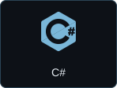
  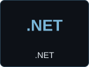
  
  
</p>

<p>
  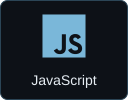
  
  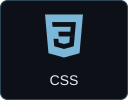
</p>

<p>
  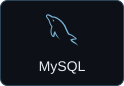
  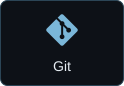
  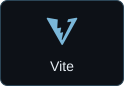
  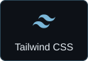
</p>

<details>
  <summary>Outros estudos</summary>

React · Next.js · Python · PHP

</details>

## Projetos em destaque

<a href="https://github.com/gustavo-brandao/landing-karina-ramai">
  <picture>
    <source media="(max-width: 600px)" srcset="assets/project-landing-karina-ramai-mobile.svg">
    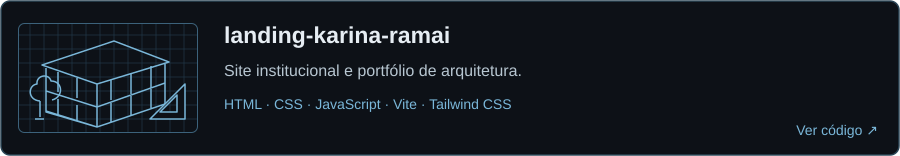
  </picture>
</a>

<a href="https://github.com/gustavo-brandao/calculadora-csharp">
  <picture>
    <source media="(max-width: 600px)" srcset="assets/project-calculadora-csharp-mobile.svg">
    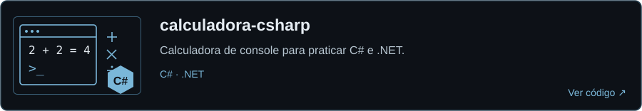
  </picture>
</a>

<a href="https://github.com/gustavo-brandao/clone-tabnews">
  <picture>
    <source media="(max-width: 600px)" srcset="assets/project-clone-tabnews-mobile.svg">
    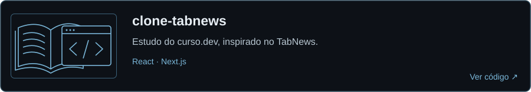
  </picture>
</a>

<details>
  <summary>Ver projetos em texto</summary>

- [landing-karina-ramai](https://github.com/gustavo-brandao/landing-karina-ramai): site institucional e portfólio de arquitetura — HTML, CSS, JavaScript, Vite e Tailwind CSS.
- [calculadora-csharp](https://github.com/gustavo-brandao/calculadora-csharp): calculadora de console para praticar C# e .NET.
- [clone-tabnews](https://github.com/gustavo-brandao/clone-tabnews): estudo do curso.dev, inspirado no TabNews — React e Next.js.

</details>

## Contribuições em modo arcade

<picture>
  <source media="(prefers-reduced-motion: reduce)" srcset="assets/pacman-still.svg">
  
</picture>

## Tempo de código

<picture>
  <source media="(prefers-reduced-motion: reduce)" srcset="assets/wakatime-still.svg">
  
</picture>

<details>
  <summary>Ver os tempos em texto</summary>

<!--START_SECTION:waka-->

```text
Últimos 7 dias
Atualizado em 2026-11-01 (UTC)
JavaScript             50 min   63.5%
JSON                   12 min   15.8%
Total registrado: 1 h 04 min
```

<!--END_SECTION:waka-->

</details>
