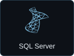
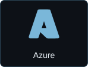
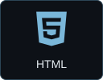

<picture>
  <source media="(prefers-reduced-motion: reduce)" srcset="assets/banner.png">
  
</picture>

# Gustavo Brandão Gimenez

Atuo com suporte técnico, infraestrutura de redes e ensino universitário. Aqui compartilho projetos e estudos com foco no ecossistema Microsoft — C#, .NET, SQL Server e Azure —, além de desenvolvimento web.

Também gosto de jogos, dos clássicos aos atuais. Os jogos retrôs e a pixel art serviram de inspiração para a identidade visual deste perfil.

<p>
  <a href="https://www.linkedin.com/in/gustavo-brand%C3%A3o-gimenez-221a621b4/"></a>
  <a href="mailto:brandaogimenez@gmail.com"></a>
  <a href="https://www.twitch.tv/brandovski19"></a>
  <a href="https://www.instagram.com/dev_estudante/"></a>
  <a href="https://www.youtube.com/channel/UCXSyWSO_gzJ9z8CBdX29ttQ"></a>
</p>

## Tecnologias

<p>
  
  
  
  
</p>

<p>
  
  
  
</p>

<p>
  
  
  
  
</p>

<details>
  <summary>Outros estudos</summary>

React · Next.js · Python · PHP

</details>

## Projetos em destaque

| Projeto | Sobre | Tecnologias |
| :--- | :--- | :--- |
| [landing-karina-ramai](https://github.com/gustavo-brandao/landing-karina-ramai) | Landing page institucional com portfólio e visual editorial. | HTML · CSS · JavaScript · Vite · Tailwind CSS |
| [calculadora-csharp](https://github.com/gustavo-brandao/calculadora-csharp) | Prática de fundamentos com uma calculadora de console. | C# · .NET |
| [clone-tabnews](https://github.com/gustavo-brandao/clone-tabnews) | Projeto de aprendizado em estágio inicial. | React · Next.js |

## Contribuições em modo arcade

<picture>
  <source media="(prefers-reduced-motion: reduce)" srcset="assets/pacman-still.svg">
  
</picture>

## Tempo de código

<picture>
  <source media="(prefers-reduced-motion: reduce)" srcset="assets/wakatime-still.svg">
  
</picture>

<details>
  <summary>Ver os tempos em texto</summary>

<!--START_SECTION:waka-->

```text
Últimos 7 dias
Aguardando a primeira atualização automática.
```

<!--END_SECTION:waka-->

</details>
